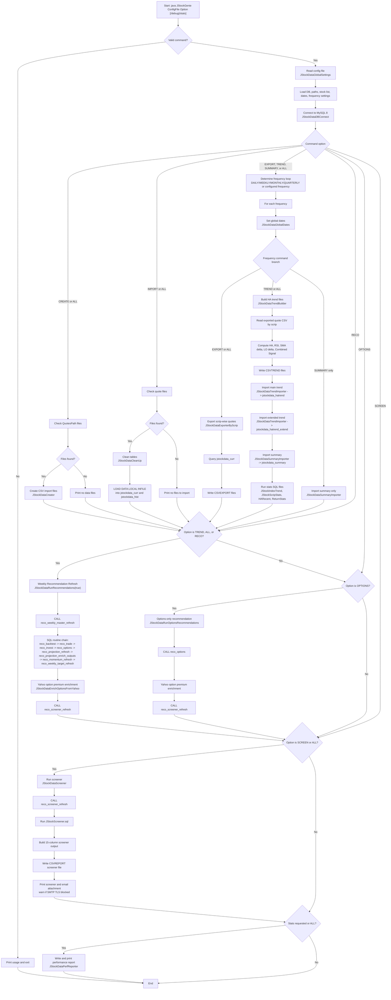

# JStockGenie Java Process Flow

Source reviewed: `D:\DB011-JWORK\JProgramming\MyJava\workspace\JStockGenie\JStockGenie.java`

## Main Command Meanings

| Command | Primary Java path | Main output |
|---|---|---|
| `CREATE` | `JStockDataCreator` | CSV import files from raw quotes |
| `IMPORT` | `JStockDataCleanUp` -> `LOAD DATA LOCAL INFILE` | `jstockdata_curr`, `jstockdata_hist` |
| `EXPORT` | `JStockDataExporterByScrip` | Scrip-wise quote CSV files |
| `TREND` | `JStockDataTrendBuilder` -> trend imports -> recommendations | Trend tables, reco tables, screener refresh |
| `SUMMARY` | `JStockDataSummaryImporter` | `jstockdata_summary` |
| `RECO` | `JStockDataRunRecommendations(true)` | Weekly reco, options, screener tables |
| `OPTIONS` | `JStockDataRunOptionsRecommendations` | Options reco and screener refresh |
| `SCREEN` | `JStockDataScreener` | Screener CSV/report/email |
| `ALL` | Most paths in sequence | Full pipeline |

